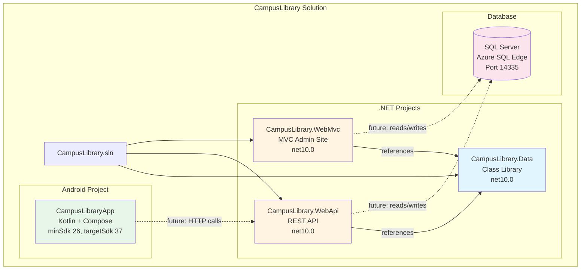
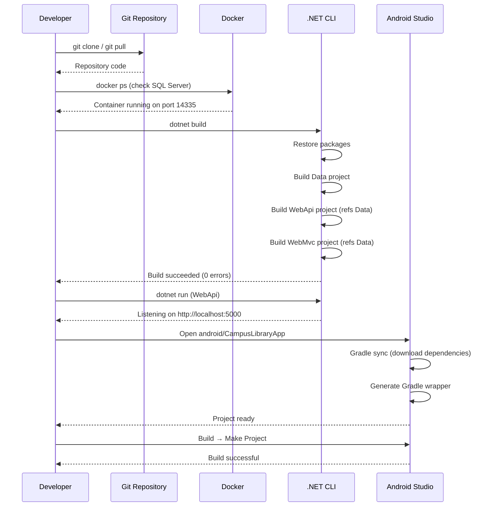
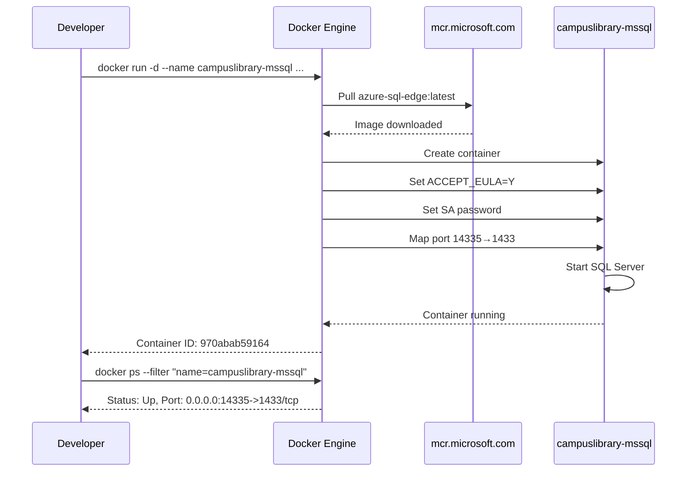
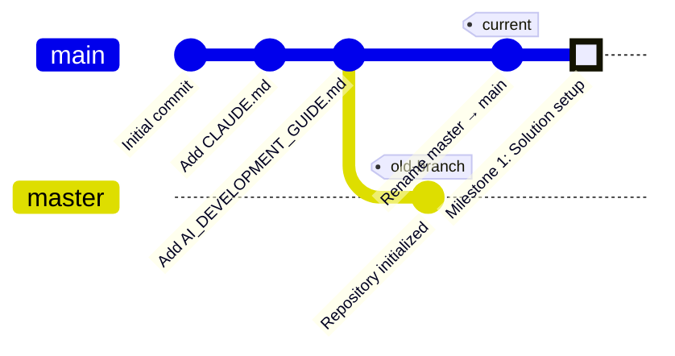
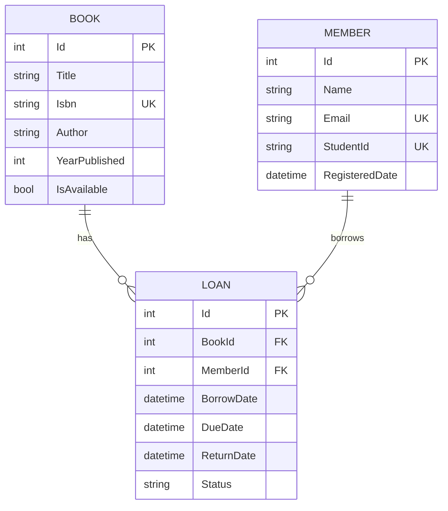

# Flowcharts — Solution Setup

> Historical milestone record. Statements and verification below describe the original task, not a fresh run. For current setup and known limitations, use [the latest report index](../INDEX.md).
> Milestone 1 records were split between 06:50 and 14:50 folders; the developer report in this folder explains the provenance. Original ports, SDK 37 proposal, wrapper assumptions and future schema are historical, not current instructions.

**Milestone:** 1  
**Date:** 2026-11-07  

---

## 1. Solution Architecture Diagram

This diagram shows the relationships between all projects in the CampusLibrary solution.



**Legend:**
- Solid lines: Project references (implemented now)
- Dashed lines: Future connections (not implemented yet)

---

## 2. Build and Deployment Flow

This sequence shows how a developer builds and runs the solution.



---

## 3. Future Data Flow (Milestone 2+)

This diagram shows how data will flow once entities, repositories, and services are implemented.

```mermaid
flowchart LR
    subgraph "Client Layer"
        BROWSER[Web Browser]
        MOBILE[Android App]
    end
    
    subgraph "Presentation Layer"
        MVC_CTRL[MVC Controller]
        API_CTRL[API Controller]
    end
    
    subgraph "Business Logic Layer"
        SVC[Service<br/>IBookService<br/>IMemberService<br/>ILoanService]
    end
    
    subgraph "Data Access Layer"
        REPO[Repository<br/>IBookRepository<br/>IMemberRepository<br/>ILoanRepository]
        CTX[LibraryDbContext<br/>DbSet&lt;Book&gt;<br/>DbSet&lt;Member&gt;<br/>DbSet&lt;Loan&gt;]
    end
    
    subgraph "Database"
        SQL[(SQL Server<br/>CampusLibraryDb<br/>Port 14335)]
    end
    
    BROWSER -->|HTTP Request| MVC_CTRL
    MOBILE -->|HTTP/JSON| API_CTRL
    
    MVC_CTRL -->|calls| SVC
    API_CTRL -->|calls| SVC
    
    SVC -->|calls| REPO
    
    REPO -->|LINQ queries| CTX
    
    CTX -->|EF Core<br/>ToListAsync()<br/>SaveChangesAsync()| SQL
    
    style SVC fill:#fff4e1
    style REPO fill:#e1f5ff
    style CTX fill:#e1f5ff
    style SQL fill:#fce4ec
```

**Note:** This architecture follows the **AI_DEVELOPMENT_GUIDE.md** pattern:
```
Controller → Service → Repository → EF Core → SQL Server
```

---

## 4. Project Structure (File System)

```mermaid
graph TD
    ROOT[CampusLibrary/]
    
    ROOT --> SLN[CampusLibrary.sln]
    ROOT --> CLAUDE[CLAUDE.md]
    ROOT --> AI_GUIDE[AI_DEVELOPMENT_GUIDE.md]
    ROOT --> SPEC[SPEC.md]
    ROOT --> GITIGNORE[.gitignore]
    
    ROOT --> SRC[src/]
    SRC --> DATA_DIR[CampusLibrary.Data/]
    SRC --> API_DIR[CampusLibrary.WebApi/]
    SRC --> MVC_DIR[CampusLibrary.WebMvc/]
    
    DATA_DIR --> DATA_CSPROJ[CampusLibrary.Data.csproj]
    DATA_DIR --> CLASS1[Class1.cs]
    DATA_DIR -.->|future| ENTITIES[Entities/<br/>Book.cs<br/>Member.cs<br/>Loan.cs]
    DATA_DIR -.->|future| REPOS[Repositories/<br/>Interfaces/<br/>BookRepository.cs]
    DATA_DIR -.->|future| DBCONTEXT[LibraryDbContext.cs]
    
    API_DIR --> API_CSPROJ[CampusLibrary.WebApi.csproj]
    API_DIR --> API_PROGRAM[Program.cs]
    API_DIR --> API_SETTINGS[appsettings.json<br/>appsettings.Development.json]
    API_DIR -.->|future| API_CONTROLLERS[Controllers/<br/>BooksController.cs]
    API_DIR -.->|future| API_SERVICES[Services/<br/>BookService.cs]
    API_DIR -.->|future| API_DTOS[DTOs/<br/>BookDto.cs]
    
    MVC_DIR --> MVC_CSPROJ[CampusLibrary.WebMvc.csproj]
    MVC_DIR --> MVC_PROGRAM[Program.cs]
    MVC_DIR --> MVC_SETTINGS[appsettings.json<br/>appsettings.Development.json]
    MVC_DIR --> MVC_CONTROLLERS[Controllers/<br/>HomeController.cs]
    MVC_DIR --> MVC_VIEWS[Views/<br/>Home/<br/>Shared/]
    MVC_DIR -.->|future| MVC_BOOK_VIEWS[Views/<br/>Books/<br/>Members/<br/>Loans/]
    
    ROOT --> ANDROID_DIR[android/]
    ANDROID_DIR --> ANDROID_APP[CampusLibraryApp/]
    ANDROID_APP --> GRADLE_BUILD[build.gradle.kts]
    ANDROID_APP --> GRADLE_SETTINGS[settings.gradle.kts]
    ANDROID_APP --> GRADLE_PROPS[gradle.properties]
    ANDROID_APP --> GRADLE_LIBS[gradle/<br/>libs.versions.toml]
    ANDROID_APP --> APP_DIR[app/]
    APP_DIR --> APP_BUILD[build.gradle.kts]
    APP_DIR --> APP_MANIFEST[src/main/<br/>AndroidManifest.xml]
    APP_DIR --> APP_KOTLIN[src/main/java/<br/>com/campus/library/<br/>MainActivity.kt]
    APP_DIR -.->|future| APP_SCREENS[ViewModels/<br/>Screens/<br/>Repository/]
    
    ROOT --> DOCS[docs/]
    DOCS --> REPORTS[reports/]
    REPORTS --> INDEX_MD[INDEX.md]
    REPORTS --> REPORT1[2026-11-07-1450-solution-setup/<br/>DEVELOPER-DOCS.md<br/>HOW-TO-USE.md<br/>FLOWCHARTS.md]
    
    ROOT --> TASKS[tasks/]
    TASKS --> PLAN[plan.md]
    TASKS --> TODO[todo.md]
    
    style DATA_DIR fill:#e1f5ff
    style API_DIR fill:#fff4e1
    style MVC_DIR fill:#fff4e1
    style ANDROID_APP fill:#e8f5e9
    style ENTITIES fill:#ddd
    style REPOS fill:#ddd
    style DBCONTEXT fill:#ddd
    style API_CONTROLLERS fill:#ddd
    style API_SERVICES fill:#ddd
    style API_DTOS fill:#ddd
    style MVC_BOOK_VIEWS fill:#ddd
    style APP_SCREENS fill:#ddd
```



**Legend:**
- Solid boxes: Files/folders created in Milestone 1
- Dashed boxes: Future additions (Milestones 2-7)

---

## 5. Docker Container Setup



---

## 6. Git Branch Structure



**Note:** The repository was originally on `master` branch, renamed to `main` in this milestone.

---

## 7. Future Database Schema (Milestone 2)

This ERD shows the database structure that will be created in Milestone 2.



**Business rules (to be implemented in Milestone 4):**
- A book can have at most one open loan (where `ReturnDate IS NULL`)
- A member can borrow multiple books
- `Isbn` is unique (one physical book per record)
- `Email` and `StudentId` are unique per member

---

## Summary

This milestone created the **infrastructure** for the CampusLibrary solution:
- ✅ .NET solution with 3 projects and proper references
- ✅ Android project structure with Gradle configuration
- ✅ SQL Server container running on port 14335
- ✅ Git repository on `main` branch
- ✅ Documentation structure in `docs/reports/`

**No application logic yet.** Entities, repositories, services, controllers, and UI will be implemented in Milestones 2-7 following the **AI_DEVELOPMENT_GUIDE.md** architecture pattern.
