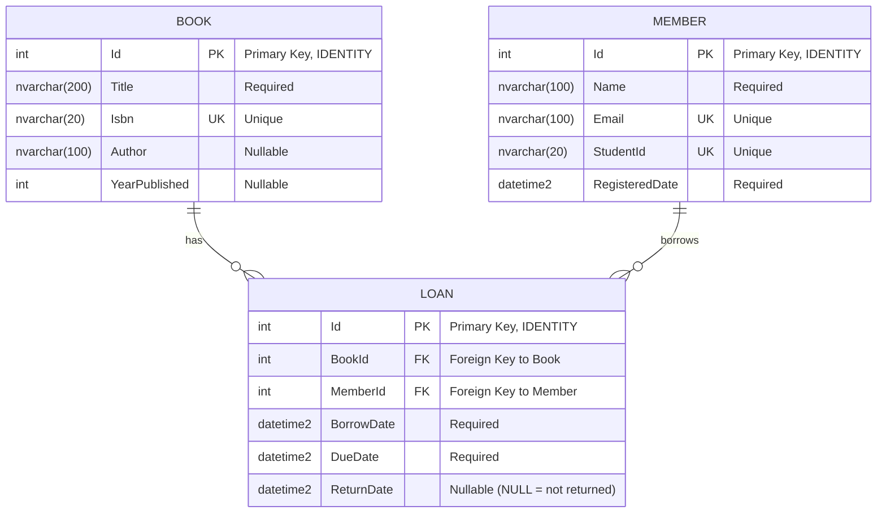
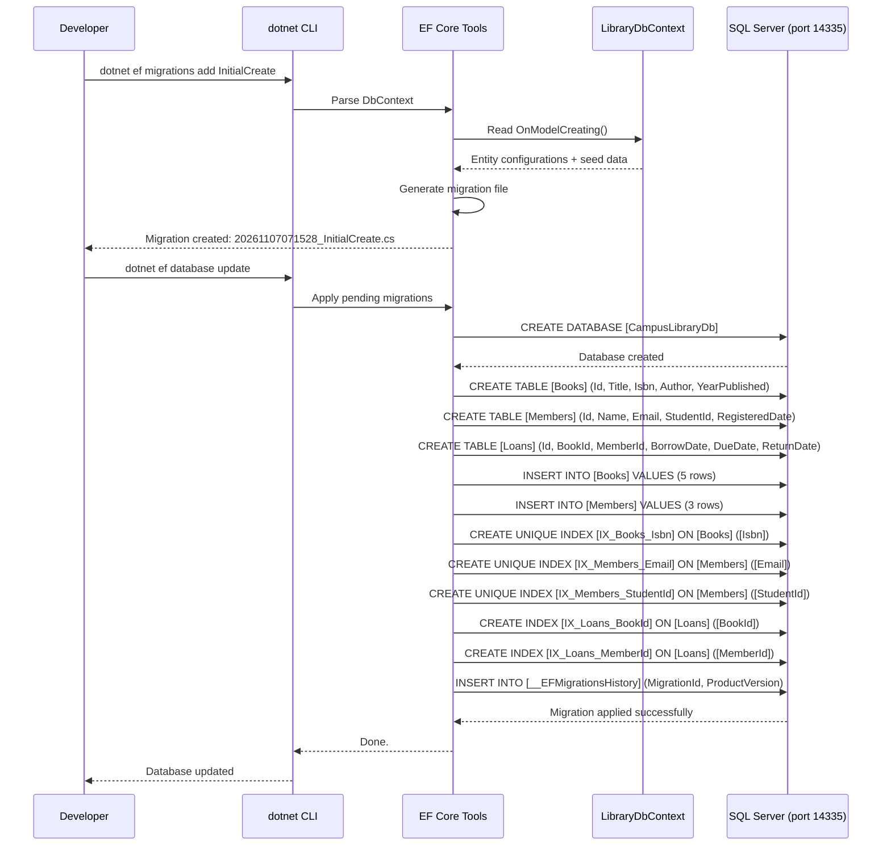
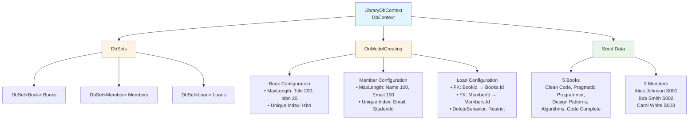
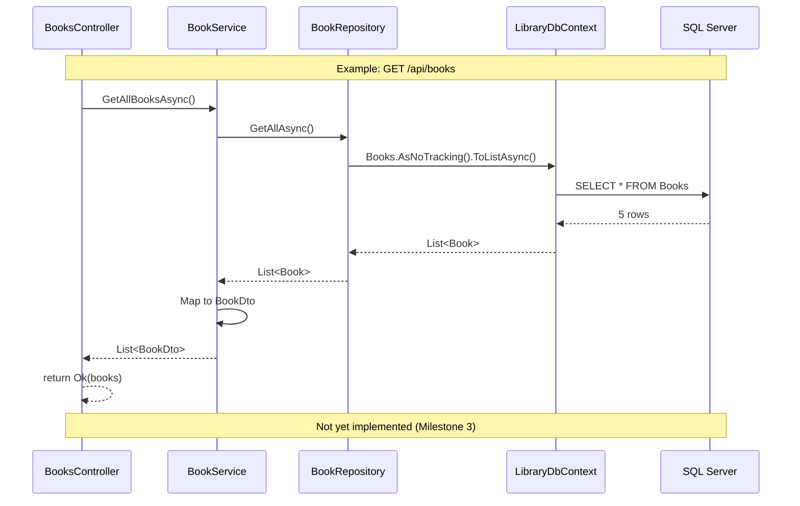
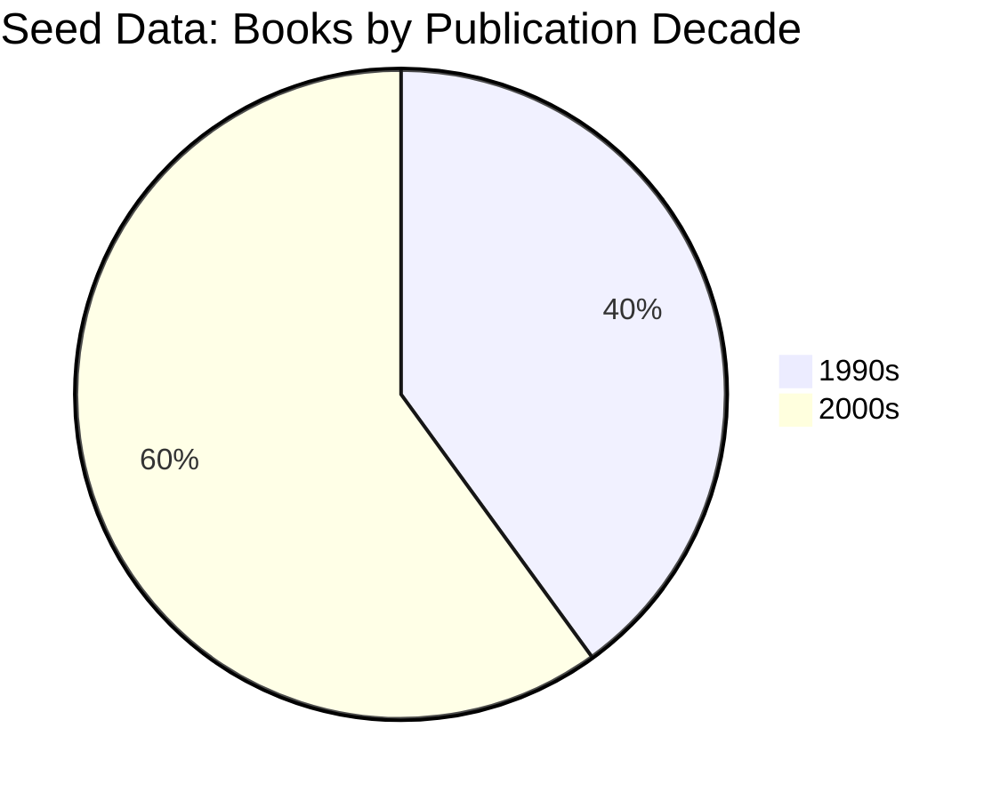
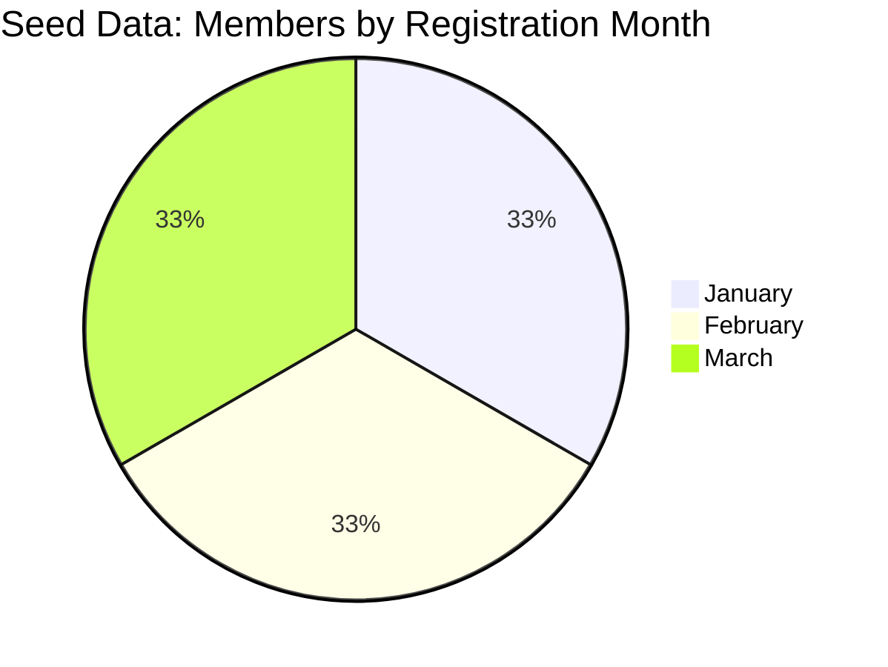
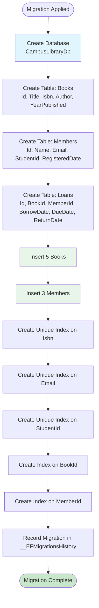
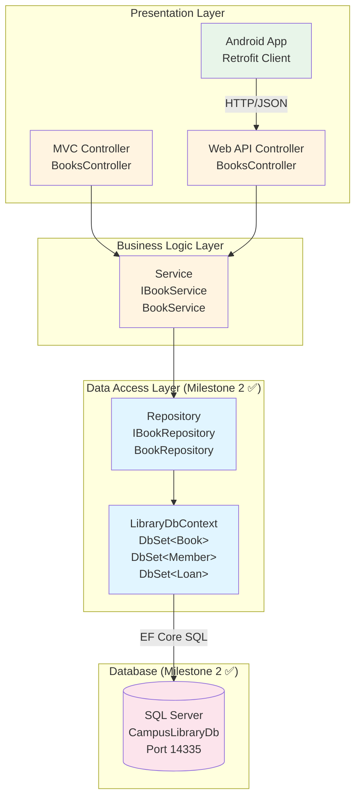
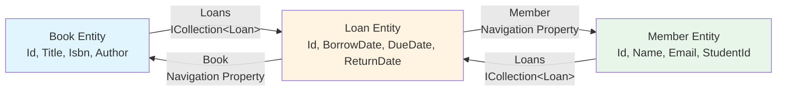

# Flowcharts — EF Core Entities, DbContext & Migration

> Historical milestone record. Statements and verification below describe the original task, not a fresh run. For current setup and known limitations, use [the latest report index](../INDEX.md).

**Milestone:** 2  
**Date:** 2026-11-07  

---

## 1. Entity Relationship Diagram (ERD)

This diagram shows the database schema with relationships, keys, and constraints.



**Key constraints:**
- **One Book → Many Loans** (a book can be borrowed multiple times over its lifetime)
- **One Member → Many Loans** (a member can borrow multiple books)
- **Delete Behavior:** `RESTRICT` (cannot delete a book or member with existing loan records)
- **Business rule (not enforced by DB):** A book can have at most one open loan (where `ReturnDate IS NULL`) — will be enforced in service layer in Milestone 4

---

## 2. Migration Flow

This sequence shows how the migration was created and applied to the database.



---

## 3. DbContext Structure

This diagram shows how the DbContext is organized with entities, DbSets, and configuration.



---

## 4. EF Core Query Flow (Future — Milestone 3+)

This shows how queries will flow from controllers through services and repositories to the database.



**Key points (per AI_DEVELOPMENT_GUIDE.md):**
- Controllers call services (never DbContext directly)
- Services call repositories (business logic layer)
- Repositories call DbContext (data access layer)
- All async: `ToListAsync()`, `SaveChangesAsync()`
- Read-only queries use `AsNoTracking()`

---

## 5. Seed Data Distribution





---

## 6. Database Schema Creation Flow



---

## 7. Future Architecture (Milestone 3+)

This shows where the DbContext fits in the complete application architecture.



**Legend:**
- ✅ Blue = Implemented in Milestone 2
- ⏭️ Yellow/Green = Coming in Milestones 3-7

---

## 8. EF Core Entity Navigation Properties



**How it works:**
- `Book.Loans` gives all loans for that book
- `Member.Loans` gives all loans for that member
- `Loan.Book` navigates back to the book
- `Loan.Member` navigates back to the member

**Example query (Milestone 3+):**
```csharp
var book = await _context.Books
    .Include(b => b.Loans)
    .ThenInclude(l => l.Member)
    .FirstOrDefaultAsync(b => b.Id == 1);

// book.Loans[0].Member.Name → "Alice Johnson"
```

---

## Summary

**Milestone 2 completed:**
- ✅ 3 entities with navigation properties
- ✅ LibraryDbContext with configuration and seed data
- ✅ Database created with 3 tables, 6 indexes, 2 foreign keys
- ✅ 5 books and 3 members seeded

**Next milestone (3):**
- Implement repositories (IBookRepository, BookRepository)
- Implement services (IBookService, BookService)
- Add Books API controller with CRUD endpoints
- Test with Swagger

The DbContext created in this milestone is the foundation for all future database operations.
