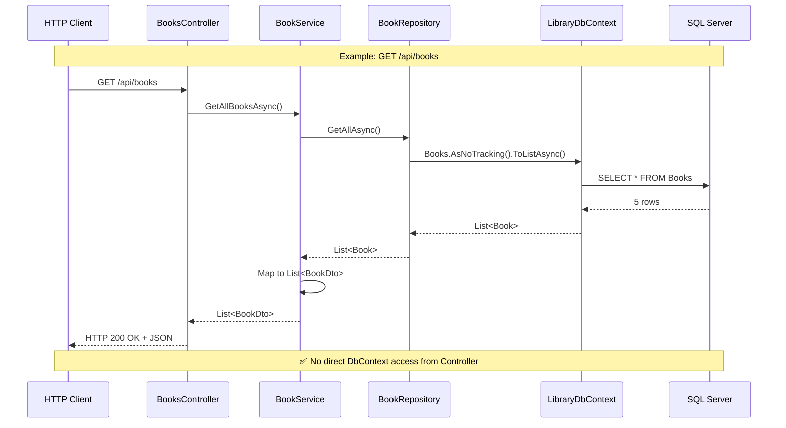
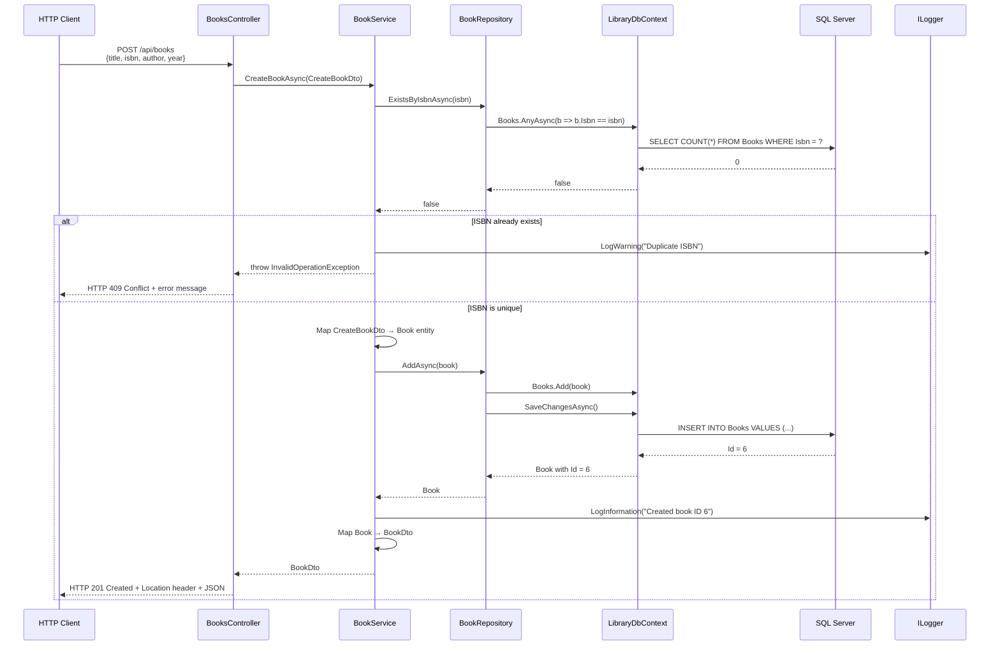
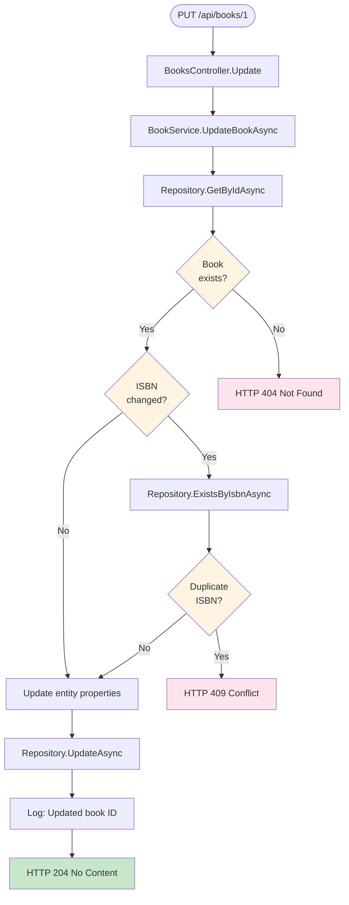
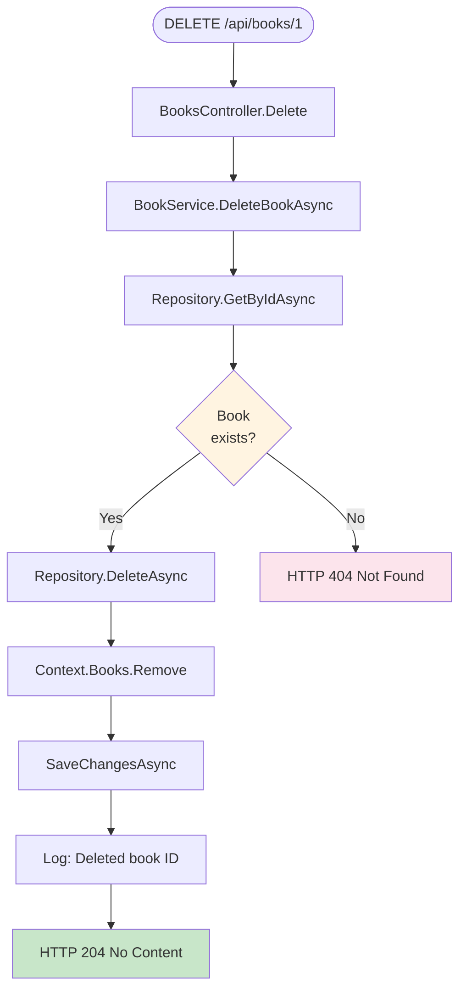
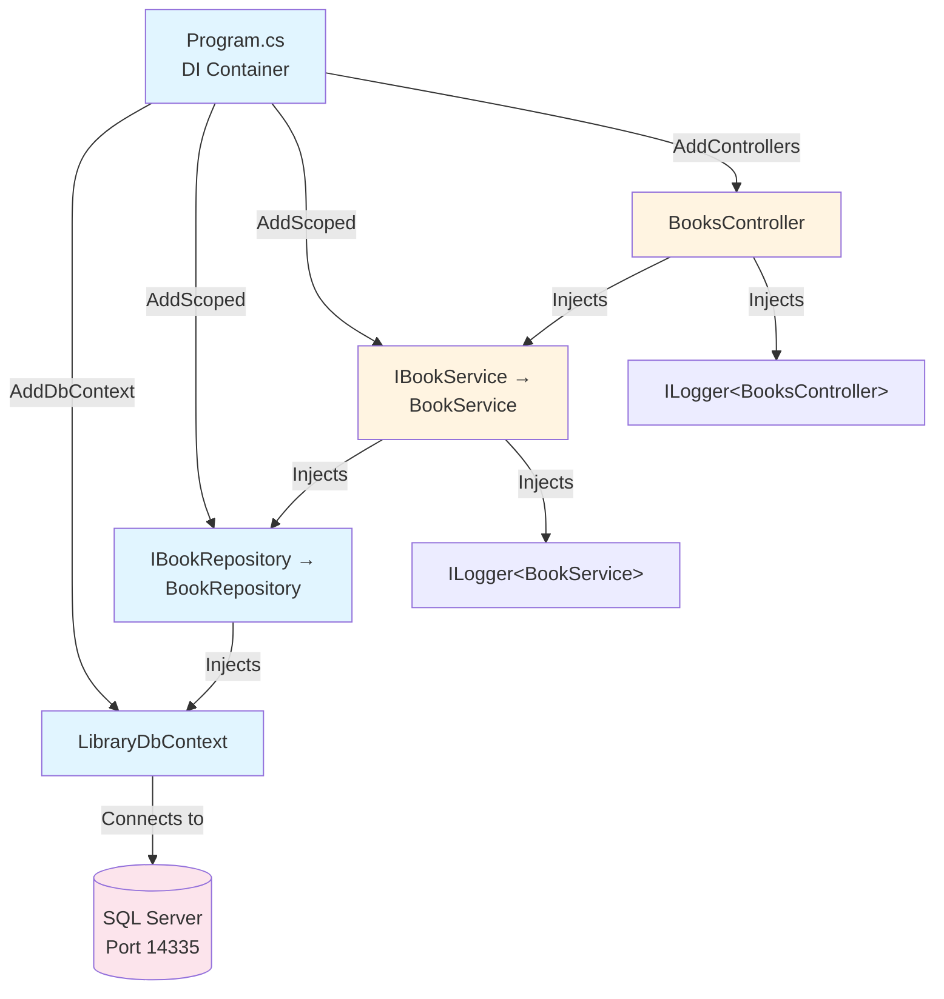
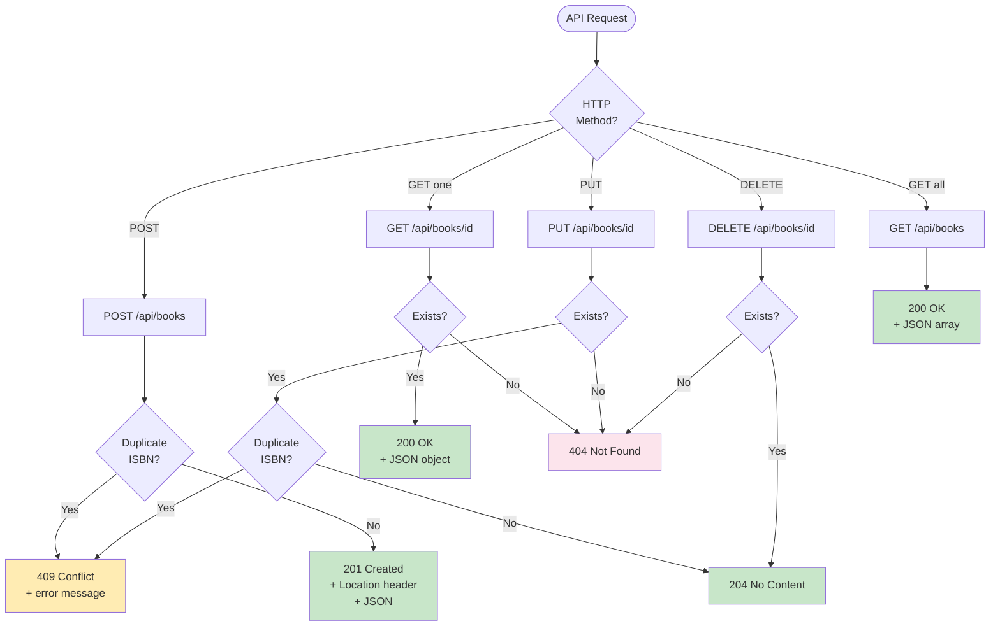
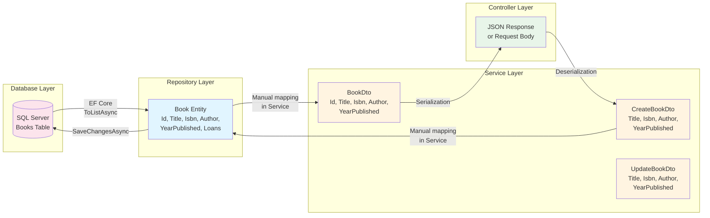
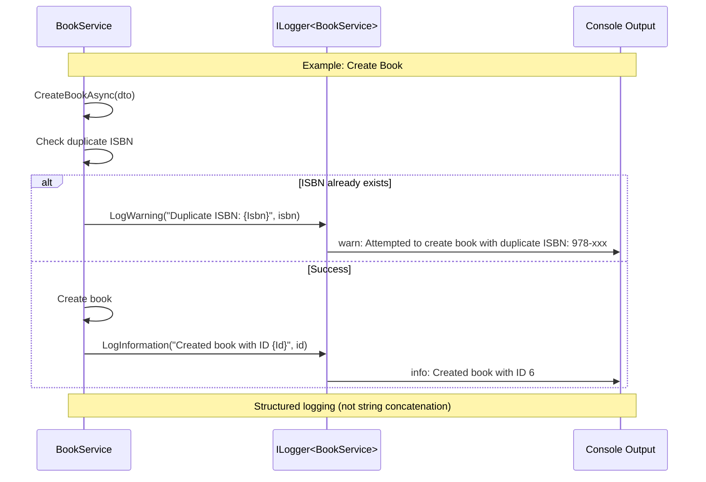
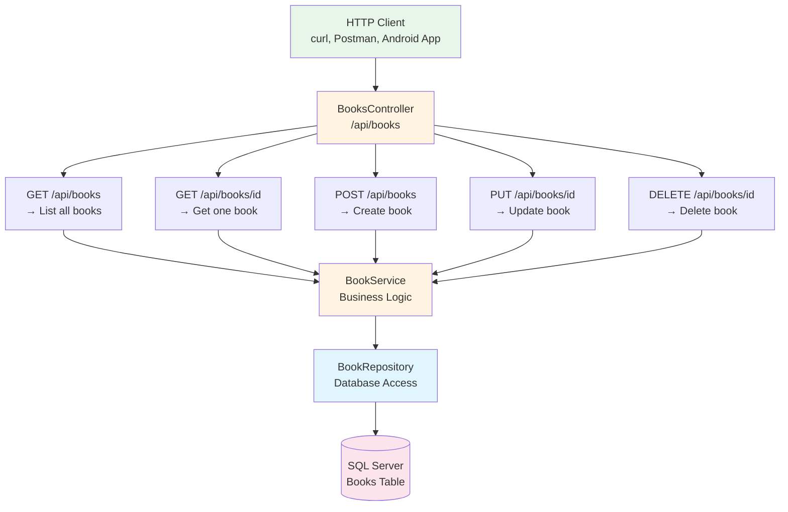
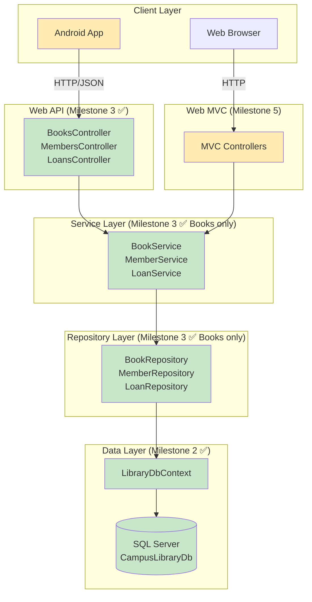

# Flowcharts — Books API CRUD

**Milestone:** 3  
**Date:** 2026-11-07  

---

## 1. Service-Repository Architecture

This diagram shows the complete request flow from HTTP to database.

---

## 2. POST (Create Book) Flow with Validation

This shows the business logic and duplicate ISBN check.

---

## 3. PUT (Update Book) Flow

---

## 4. DELETE (Delete Book) Flow

---

## 5. Dependency Injection Graph

This shows how services and repositories are wired together.

---

## 6. HTTP Status Codes Decision Tree

---

## 7. Data Mapping Flow

This shows how entities are mapped to DTOs at each layer.

**Why separate DTOs:**
- **Repository → Service:** Returns full `Book` entity (with navigation properties)
- **Service → Controller:** Returns `BookDto` (no navigation properties, clean API contract)
- **Controller → Service (POST):** Accepts `CreateBookDto` (no `Id`, auto-generated)
- **Controller → Service (PUT):** Accepts `UpdateBookDto` (all fields for update)

---

## 8. Logging Flow

**Key points:**
- Uses `ILogger<T>` for structured logging
- Logs warnings for business rule violations
- Logs information for successful operations
- Includes parameters like `{Id}`, `{Isbn}` for searchability

---

## 9. Complete CRUD Operations Overview

---

## 10. Future Architecture (Complete System)

This shows where the Books API fits in the complete CampusLibrary system.

**Legend:**
- 🟢 Green = Implemented (Milestones 2-3)
- 🟡 Yellow = Coming soon (Milestones 4-7)

---

## Summary

**Milestone 3 completed:**
- ✅ Full CRUD API for Books
- ✅ Service-Repository pattern (3 layers: Controller, Service, Repository)
- ✅ Business logic (duplicate ISBN validation)
- ✅ Proper HTTP status codes (200, 201, 204, 404, 409)
- ✅ Structured logging
- ✅ Dependency injection
- ✅ DTO mapping

**Next milestone (4):**
- Add Members CRUD (`/api/members`)
- Add Loans endpoints (`/api/loans`, `/api/loans/{id}/return`)
- Implement business rule: one book = max one open loan

The architecture established in this milestone (Controller → Service → Repository) will be replicated for Members and Loans.
