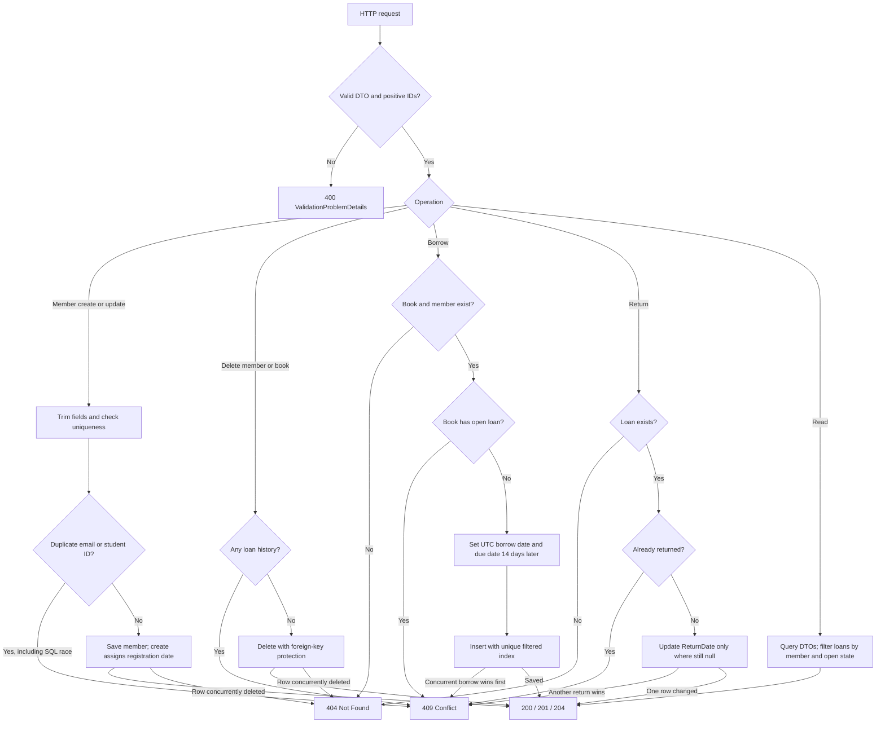
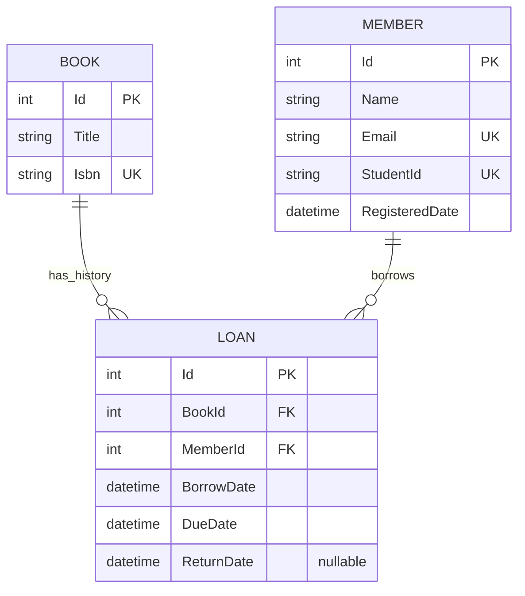

# Milestone 4 — Flowcharts

> Historical milestone record. Statements and verification below describe the original task, not a fresh run. For current setup and known limitations, use [the latest report index](../INDEX.md).

## Feature logic



Missing detail/update/delete targets return 404; a loan list filter with no matches returns an empty 200 list. Unexpected failures return generic 500 ProblemDetails and log server-side.

## Layer sequence

```mermaid
sequenceDiagram
    actor User as API client
    participant C as LoansController
    participant S as LoanService
    participant R as Repositories
    participant EF as LibraryDbContext / EF Core
    participant DB as MSSQL
    User->>C: POST /api/loans with bookId and memberId
    C->>C: Validate request
    C->>S: BorrowBookAsync(dto)
    S->>R: Find book, member and open loan
    R->>EF: Async LINQ queries
    EF->>DB: SELECT
    DB-->>S: Results via EF and repositories
    alt Missing book or member
        S-->>C: KeyNotFoundException
        C-->>User: Handler returns 404 ProblemDetails
    else Book unavailable
        S-->>C: InvalidOperationException
        C-->>User: Handler returns 409 ProblemDetails
    else Available
        S->>S: Assign UTC dates, due in 14 days
        S->>R: AddAsync(loan)
        R->>EF: SaveChangesAsync
        EF->>DB: INSERT guarded by unique open-loan index
        alt Concurrent insert already borrowed book
            DB-->>R: Unique index violation
            R-->>C: Conflict through service and handler
            C-->>User: 409 ProblemDetails
        else Insert succeeds
            DB-->>S: Persisted loan via EF and repository
            S-->>C: LoanDto
            C-->>User: 201 Created with Location
        end
    end
    User->>C: POST /api/loans/{id}/return
    C->>S: ReturnBookAsync(id)
    S->>R: GetByIdAsync; then ReturnAsync(id, utcNow)
    R->>EF: ExecuteUpdateAsync where ReturnDate is null
    EF->>DB: Conditional UPDATE
    DB-->>S: Affected row count via EF and repository
    S-->>C: Success or already-returned conflict
    C-->>User: 204 or 409; missing loan is 404
```

Members use the same Controller → Service → Repository → EF Core → MSSQL sequence. The exception handler maps service failures to HTTP responses; controllers never access DbContext.

## Database relationships



Migration `20261107074756_EnforceOneOpenLoanPerBook` changes the Loans.BookId index to UNIQUE WHERE ReturnDate IS NULL. Multiple historical returned loans remain allowed. Existing restrictive foreign keys retain book/member loan history. No columns or tables changed.
