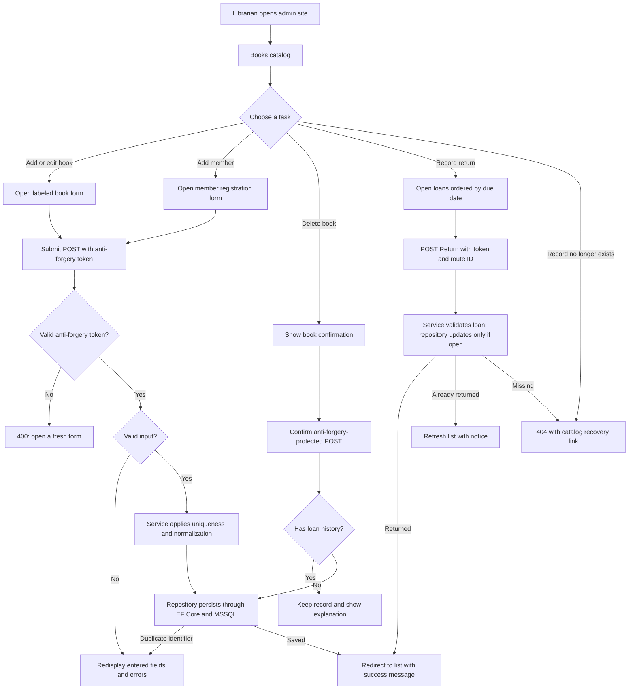
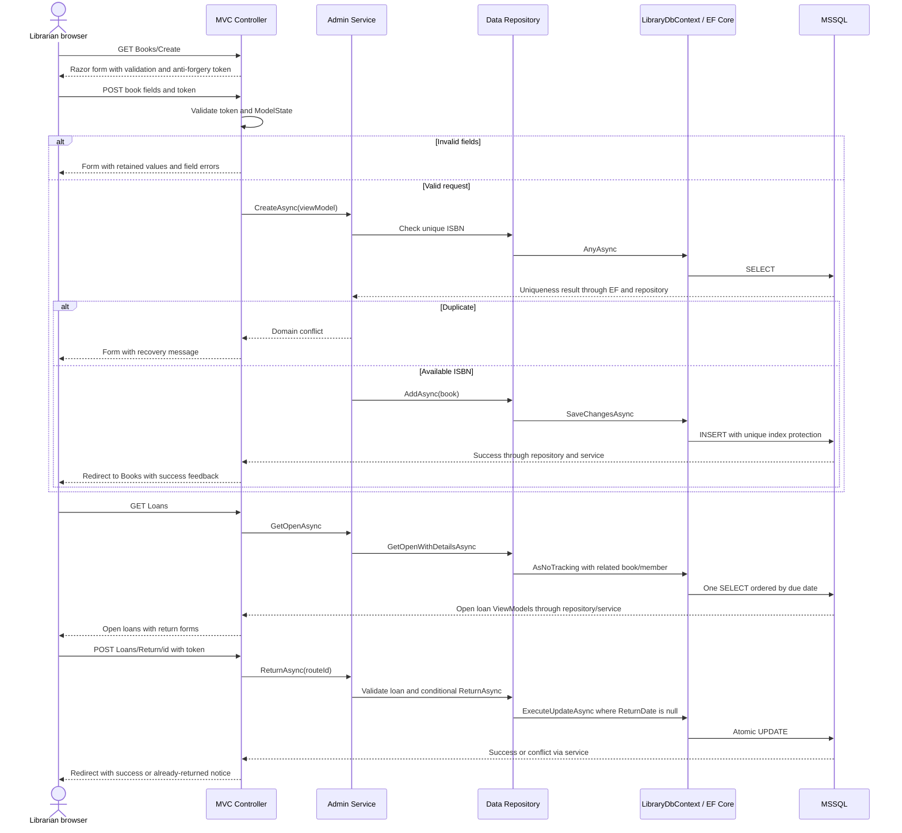

# Milestone 5 — Flowcharts

## Admin request flow

Every POST validates its anti-forgery token. Controllers use route-only IDs, services own business decisions, and database constraints guard concurrent writes.

## Cross-layer sequence

No database schema changed, so no new ER diagram is required. Existing Books/Members/Loans relationships and the one-open-loan-per-book filtered index remain as documented in Milestone 4.
