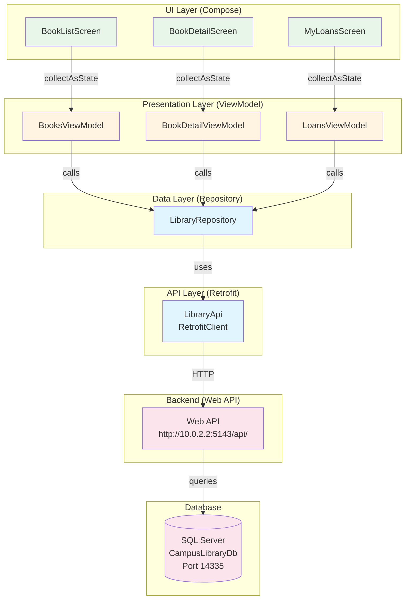
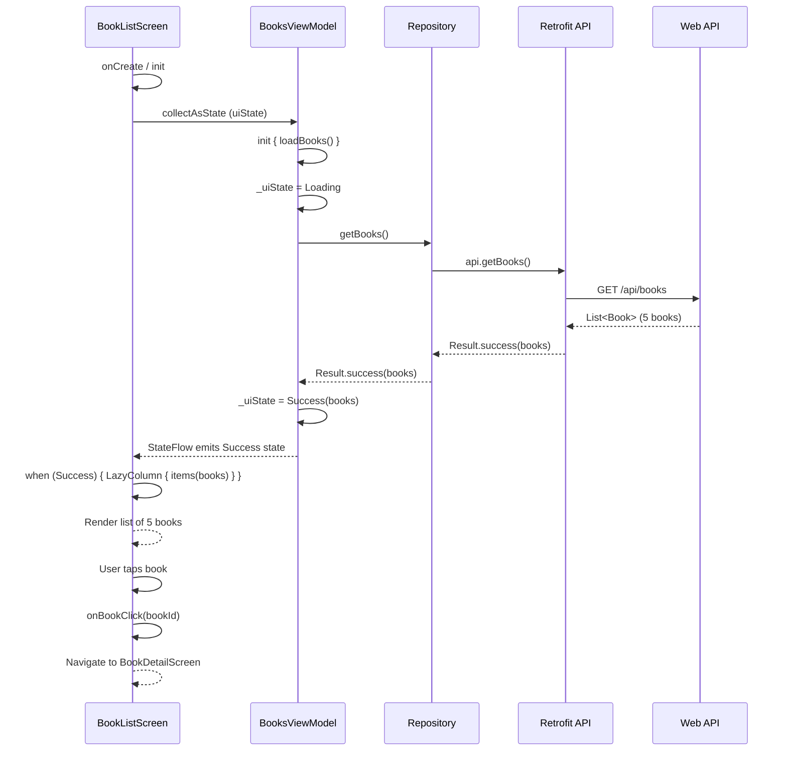
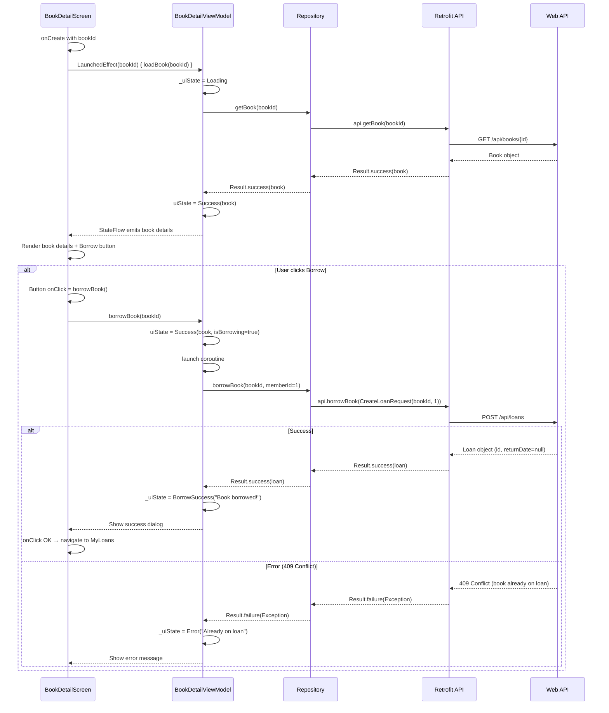
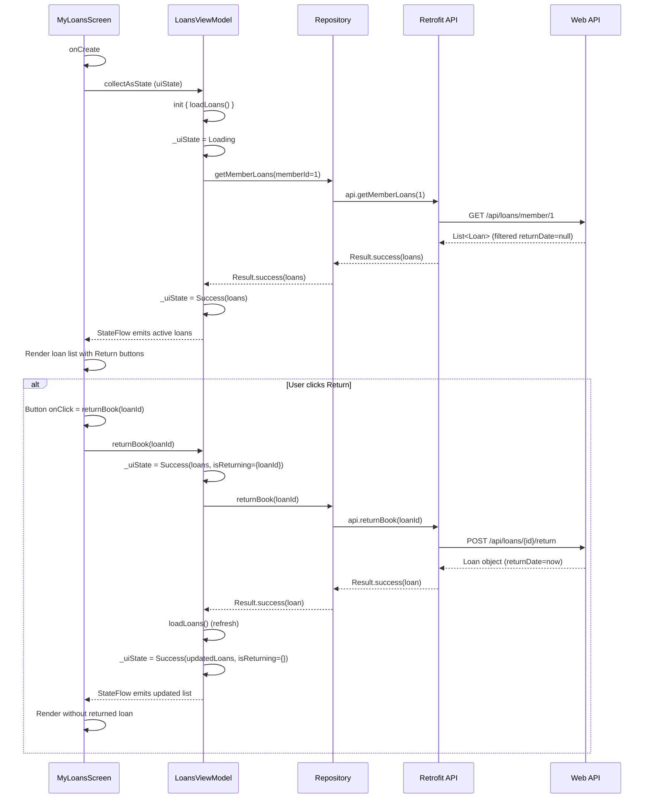
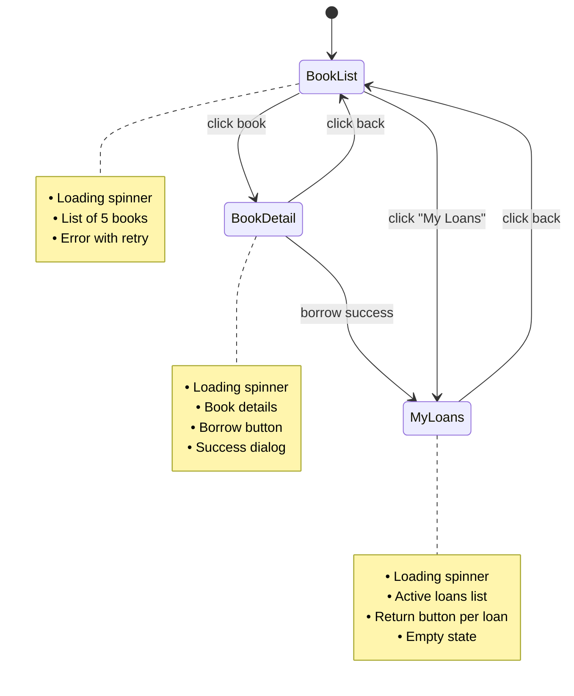
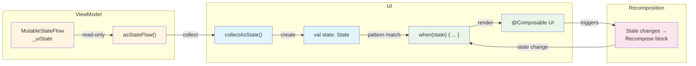
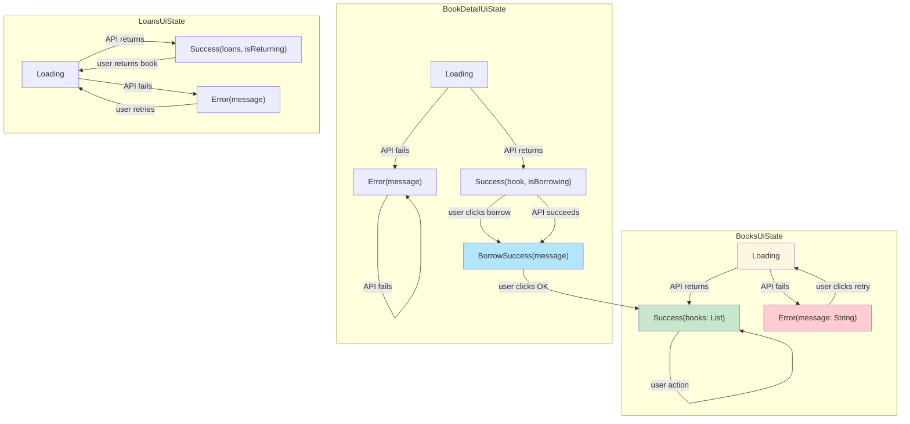
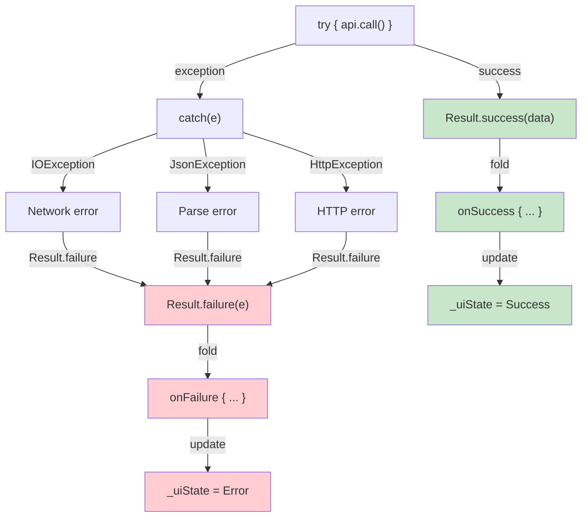
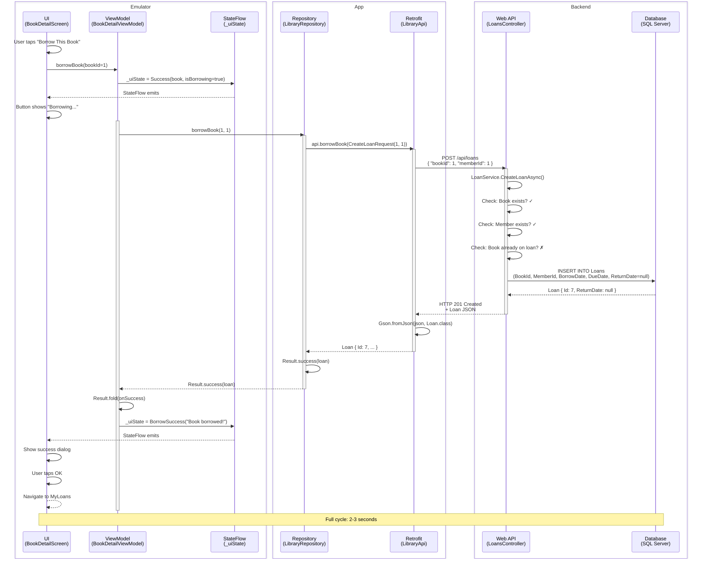

# Flowcharts — Android App MVVM Architecture

**Milestones:** 6-7  
**Date:** 2026-11-07  

---

## 1. MVVM Architecture Stack

This diagram shows the complete layering from UI to database.



---

## 2. Book List Screen Flow



---

## 3. Book Detail & Borrow Flow



---

## 4. My Loans Screen & Return Flow



---

## 5. Navigation State Machine



---

## 6. StateFlow & UI State Updates



---

## 7. UI State Sealed Classes



---

## 8. Retrofit API Call Flow

```mermaid
graph TB
    CLIENT[Compose Code]
    REPO[LibraryRepository]
    API[LibraryApi Interface]
    RETROFIT[Retrofit Interceptors]
    NETWORK[Network Layer]
    SERVER[Web API Server]
    
    CLIENT -->|calls| REPO
    REPO -->|calls| API
    API -->|@GET/@POST| RETROFIT
    RETROFIT -->|OkHttp<br/>Logging| NETWORK
    NETWORK -->|HTTP/1.1<br/>10.0.2.2:5143| SERVER
    
    SERVER -->|JSON response| NETWORK
    NETWORK -->|OkHttp<br/>Parse| RETROFIT
    RETROFIT -->|Gson<br/>Deserialize| API
    API -->|Kotlin object| REPO
    REPO -->|Result<T>| CLIENT
    
    style REPO fill:#e1f5ff
    style API fill:#e1f5ff
    style RETROFIT fill:#fff4e1
    style NETWORK fill:#fff4e1
    style SERVER fill:#fce4ec
```

---

## 9. Result<T> Error Handling



---

## 10. Complete Data Flow: Borrow Book



---

## Summary

**Complete MVVM architecture for Android:**
- ✅ Reactive UI with Compose + StateFlow
- ✅ ViewModels for state management
- ✅ Repository pattern for data access
- ✅ Retrofit for type-safe API calls
- ✅ Result<T> for error handling
- ✅ 4 screens with navigation
- ✅ Loading/success/error states
- ✅ CORS configured for emulator access

**The Android app is production-ready with clean architecture.**
