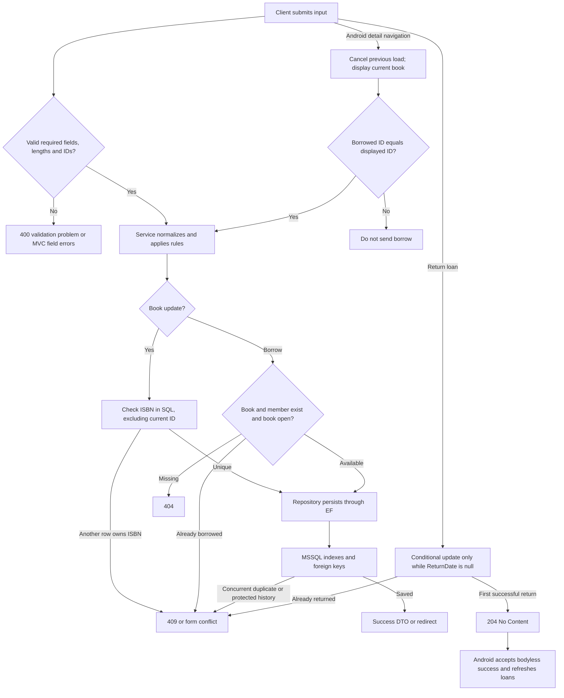
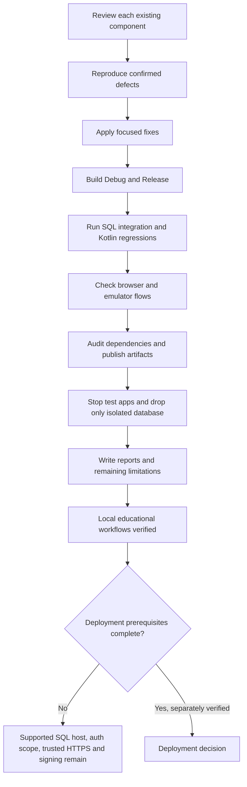

# CampusLibrary — Final review flowcharts

## Validated application behavior



## Cross-component borrowing and return

```mermaid
sequenceDiagram
    actor User
    participant UI as Compose screen
    participant VM as ViewModel / StateFlow
    participant Client as Repository / Retrofit
    participant API as API Controller
    participant S as Service
    participant R as Data Repository / EF Core
    participant DB as MSSQL
    User->>UI: Open book and choose Borrow
    UI->>VM: Load latest detail; borrow displayed ID
    VM->>VM: Cancel stale load and check ID match
    VM->>Client: borrowBook(bookId, member1)
    Client->>API: POST /api/loans
    API->>S: Validate DTO and borrow
    S->>R: Check book/member/open loan
    R->>DB: Queries then constrained INSERT
    DB-->>API: Saved loan via repository/service
    API-->>Client: 201 LoanDto
    Client-->>VM: Result success
    VM-->>UI: Current BorrowSuccess state
    User->>UI: Open My Loans
    UI->>VM: Reload on screen entry
    VM->>Client: getMemberLoans(1)
    Client->>API: GET /api/loans?memberId=1&openOnly=true
    API-->>UI: Active loans via service/repository/client/state
    User->>UI: Return book
    Client->>API: POST /api/loans/id/return
    API->>S: Return loan
    S->>R: Conditional ReturnDate update
    R->>DB: UPDATE where ReturnDate is null
    DB-->>API: One affected row via repository/service
    API-->>Client: 204 without body
    Client-->>VM: Result<Unit> success
    VM-->>UI: Reload active loans
```

MVC uses Controller → MVC Service → the same Data Repository/EF → MSSQL directly; it does not require an API process.

## Verification and deployment boundary



No database schema changed; existing entity relationships and the open-loan filtered unique index remain as documented in Milestones2/4.
