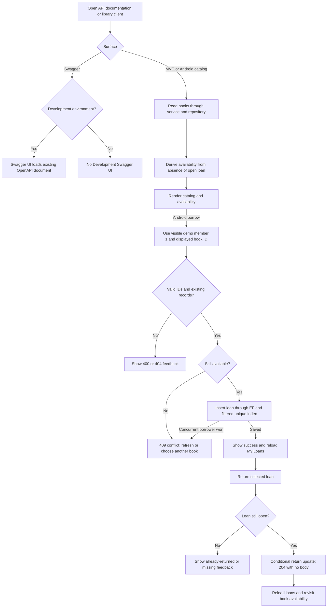

# CampusLibrary — Follow-up flows

These diagrams describe the implemented contract and intended integrated behavior; they do not assert fresh test execution. See the developer report for final verification status.

## Feature logic



MVC writes retain form validation and anti-forgery checks. Unexpected failures use safe errors; availability display never replaces the authoritative borrow rule. No authentication was added.

## Layer sequence

```mermaid
sequenceDiagram
    actor User
    participant UI as Android Compose
    participant VM as ViewModel / StateFlow
    participant HTTP as Repository / Retrofit
    participant API as API Controller
    participant S as Service
    participant R as Data Repository / EF Core
    participant DB as MSSQL
    User->>UI: Open catalog
    UI->>VM: Load books
    VM->>HTTP: getBooks()
    HTTP->>API: GET /api/books
    API->>S: GetAllBooksAsync()
    S->>R: Query books with computed availability
    R->>DB: Read books and open-loan existence
    DB-->>API: Book DTOs via repository and service
    API-->>UI: JSON including isAvailable via Retrofit/state
    User->>UI: Borrow displayed book for demo member 1
    UI->>VM: borrowBook(displayedId)
    VM->>HTTP: borrowBook(bookId, DemoMember.ID)
    HTTP->>API: POST /api/loans
    API->>S: Validate and apply borrow rules
    S->>R: Check eligibility; save loan
    R->>DB: INSERT guarded by unique open-loan index
    alt Available at write time
        DB-->>UI: 201 LoanDto through layers
        UI->>VM: Reload My Loans
        VM->>HTTP: getMemberLoans(DemoMember.ID)
        HTTP->>API: GET /api/loans?memberId=1&openOnly=true
        API-->>UI: Open loan list through layers
        User->>UI: Return loan
        HTTP->>API: POST /api/loans/id/return
        API->>S: ReturnBookAsync(id)
        S->>R: Conditional return
        R->>DB: UPDATE only where ReturnDate is null
        DB-->>UI: 204 without JSON through layers
        UI->>VM: Reload active loans
    else Already borrowed, including concurrent race
        DB-->>UI: Safe 409 conflict through layers
    end
```

MVC follows Browser → MVC Controller → MVC Service → shared Data Repository → EF Core → MSSQL, without calling Web API. No schema changed, so no new ER diagram is required; the existing filtered unique index remains authoritative.
