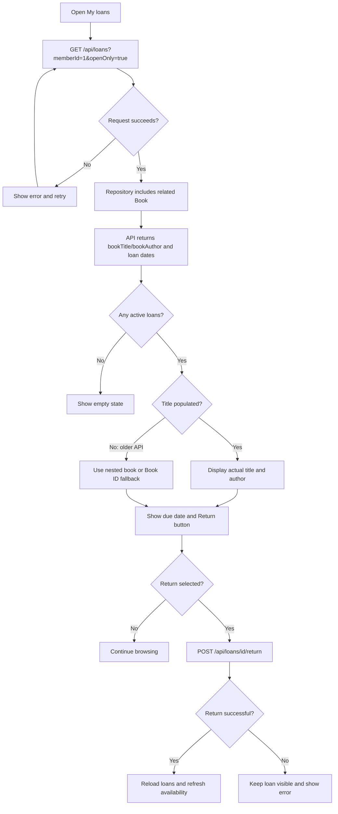
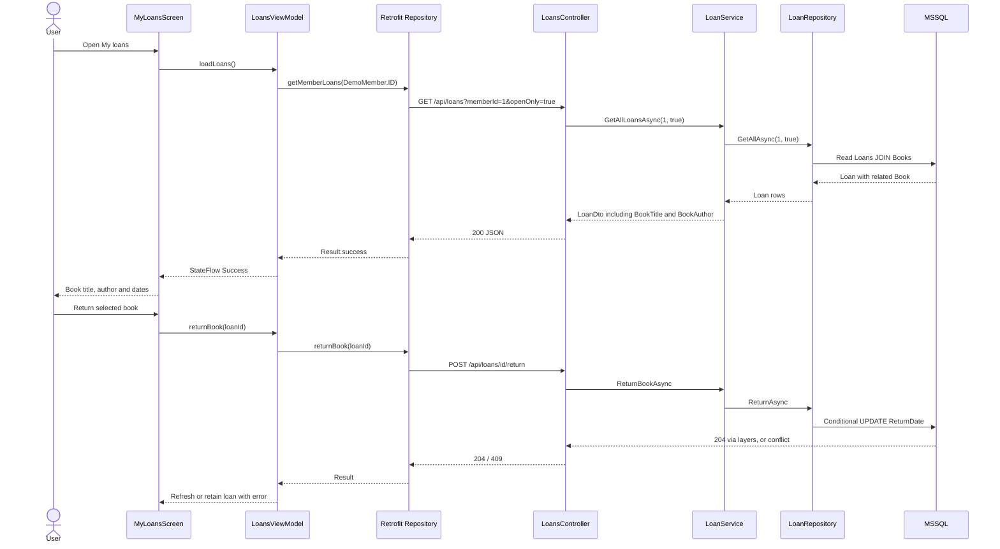

# CampusLibrary — Loan titles and borrower flows

## UI logic

## Layer sequence

No schema change; the existing Books–Loans foreign key and filtered unique index remain authoritative. An additional ER diagram is unnecessary.
