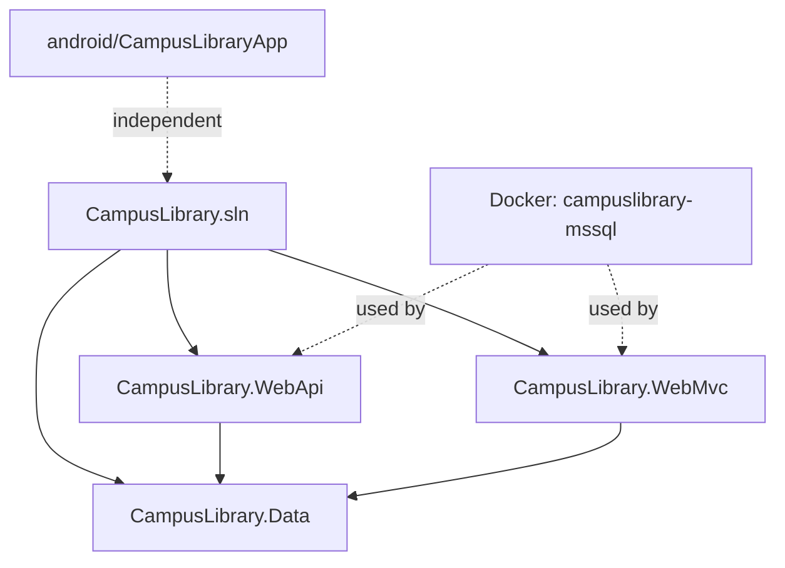

# Implementation Plan: CampusLibrary Solution Setup

**Milestone:** Create solution structure with 4 projects  
**Date:** 2026-11-07  
**Effort:** Low (infrastructure setup, no application code)

---

## Overview

This plan establishes the foundational solution structure for CampusLibrary. It creates the .NET solution file, three .NET 10 projects (Data, WebApi, WebMvc), one Android Kotlin project, and a running SQL Server container. No entities, services, repositories, or application logic are implemented yet—those come in milestone 2+.

---

## Prerequisites

✅ **Verified:**
- .NET SDK 10.0.400 installed
- Docker 29.8.2 available
- Android SDK at `~/Library/Android/sdk` with platforms 36, 37.0, 37.1
- Android Studio installed
- Java 26.0.2 (OpenJDK) available
- Apple Silicon (arm64) confirmed
- Git repository initialized on `master` branch (will switch to `main`)

---

## Components and Dependencies

**Build order:**
1. Solution file
2. CampusLibrary.Data (no dependencies)
3. CampusLibrary.WebApi (references Data)
4. CampusLibrary.WebMvc (references Data)
5. Android project (independent, gradle wrapper created by Studio)
6. SQL Server container (independent, needed for future EF migrations)

---

## Implementation Order

### Phase 1: .NET Solution Structure
**Can be done sequentially in one pass**

1. Create solution file
2. Create CampusLibrary.Data class library
3. Create CampusLibrary.WebApi project
4. Create CampusLibrary.WebMvc project
5. Add all 3 projects to solution
6. Add project references (WebApi → Data, WebMvc → Data)
7. Build solution to verify

### Phase 2: SQL Server Container
**Independent of Phase 1, but needed before milestone 2**

8. Pull Azure SQL Edge image (Apple Silicon compatible)
9. Start container with development password
10. Verify container is running and accessible

### Phase 3: Android Project Structure
**Independent of Phases 1-2**

11. Create Android project directory structure
12. Write basic `build.gradle.kts` files
13. Write `AndroidManifest.xml`
14. Write `settings.gradle.kts`
15. Note: Gradle wrapper will be generated when opened in Android Studio

### Phase 4: Repository Setup
**Sequential cleanup after Phases 1-3**

16. Create `docs/reports/` structure with INDEX.md
17. Switch git branch from `master` to `main`
18. Create `.gitignore` for .NET and Android

---

## Risks and Mitigations

| Risk | Impact | Mitigation |
|------|--------|------------|
| .NET 10 is very recent, templates may have issues | Medium | Verify `dotnet new` works; fall back to .NET 9 if blocked |
| Azure SQL Edge image pull fails | Low | Docker is working; image is official Microsoft |
| Android project won't open in Studio | Low | Create minimal valid structure; Studio will fix/generate remaining files |
| Port 1433 already in use | Low | Check with `lsof -i :1433`; use different port if needed |
| Gradle wrapper missing | Low | Expected—Studio generates it; document this in HOW-TO-USE.md |

---

## Verification Checkpoints

**After Phase 1:**
- [ ] `dotnet build` succeeds with 0 errors
- [ ] Solution file lists all 3 projects
- [ ] Project references are correct (WebApi and WebMvc both reference Data)

**After Phase 2:**
- [ ] `docker ps` shows `campuslibrary-mssql` running
- [ ] Can connect to `localhost:1433` with SA credentials

**After Phase 3:**
- [ ] `android/CampusLibraryApp/` directory exists with valid structure
- [ ] `build.gradle.kts` and `AndroidManifest.xml` are valid
- [ ] Opening in Android Studio does not show critical errors

**After Phase 4:**
- [ ] `docs/reports/INDEX.md` exists
- [ ] Git branch is `main`
- [ ] `.gitignore` excludes `bin/`, `obj/`, build artifacts

---

## Parallel Work Opportunities

- **Phase 1 and Phase 2** can run in parallel (solution creation independent of Docker)
- **Phase 3** can run in parallel with Phases 1-2 (Android is separate)
- **Phase 4** must run last (cleanup after main work)

---

## What This Plan Does NOT Include

Per ponytail principles (smallest complete change) and milestone 1 scope:

- ❌ Entity classes (Book, Member, Loan) → Milestone 2
- ❌ DbContext → Milestone 2
- ❌ EF Core NuGet packages → Milestone 2
- ❌ Repositories, services, controllers → Milestones 2-4
- ❌ DTOs, ViewModels → Milestones 3-5
- ❌ EF migrations → Milestone 2
- ❌ API endpoints → Milestones 3-4
- ❌ Razor views → Milestone 5
- ❌ Android UI screens → Milestones 6-7
- ❌ CORS configuration → Milestone 3 (when API has endpoints)
- ❌ Swagger beyond default template → Milestone 3
- ❌ Dependency injection registration beyond defaults → Milestone 2+

---

## Success Criteria

All criteria from SPEC.md:

- [x] Solution file `CampusLibrary.sln` created at repository root
- [x] Three .NET projects created under `src/` with correct framework (net10.0)
- [x] Projects added to solution file
- [x] WebApi and WebMvc both reference Data project
- [x] `dotnet build` succeeds with no errors
- [x] Docker container `campuslibrary-mssql` running and accessible on port 1433
- [x] Android project structure created under `android/CampusLibraryApp/`
- [x] Android project opens successfully in Android Studio (manual verification step)
- [x] `docs/reports/` folder structure created with initial INDEX.md
- [x] Git branch switched to `main` (not `master`)
- [x] All four projects buildable (Android via `./gradlew assembleDebug` after Studio setup)

---

## Next Steps After This Milestone

Once this plan is executed and verified:

1. **Milestone 2:** EF Core entities (Book, Member, Loan), DbContext, seed data, first migration
2. Student fills in name/section/date in CLAUDE.md
3. Commit the solution structure to git
